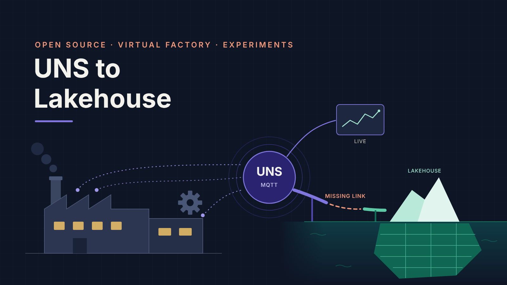
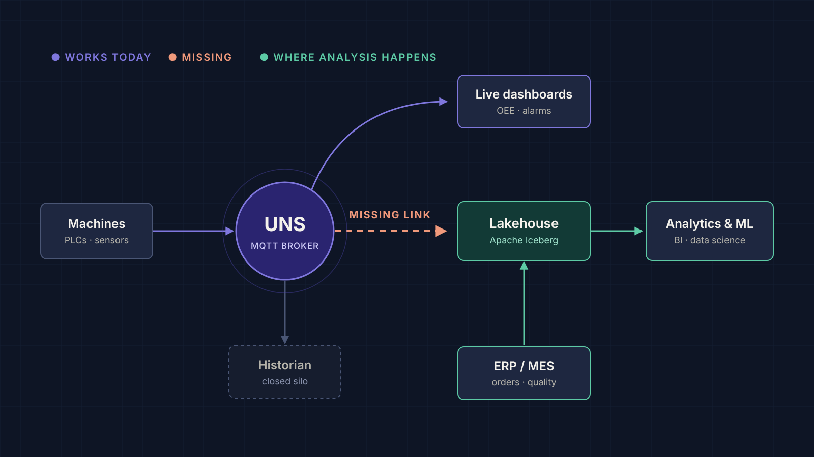
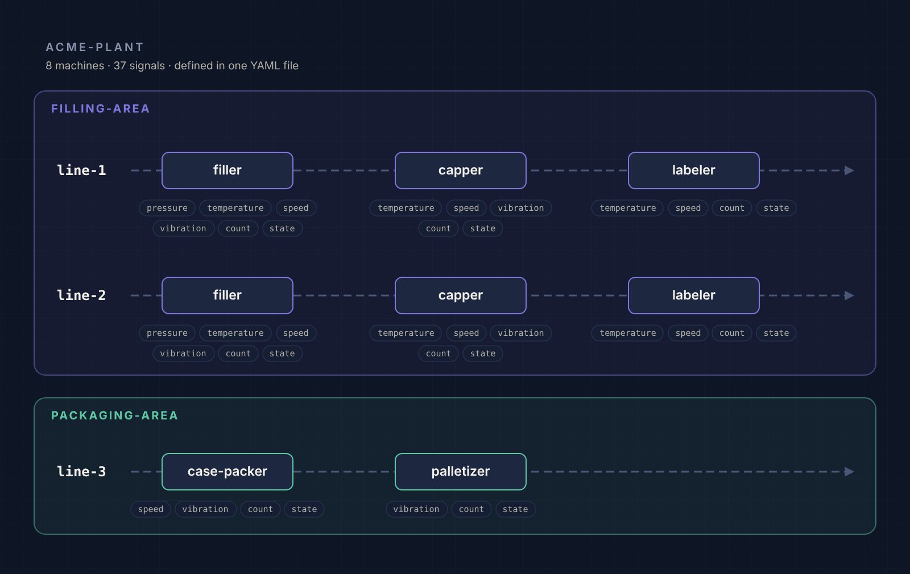
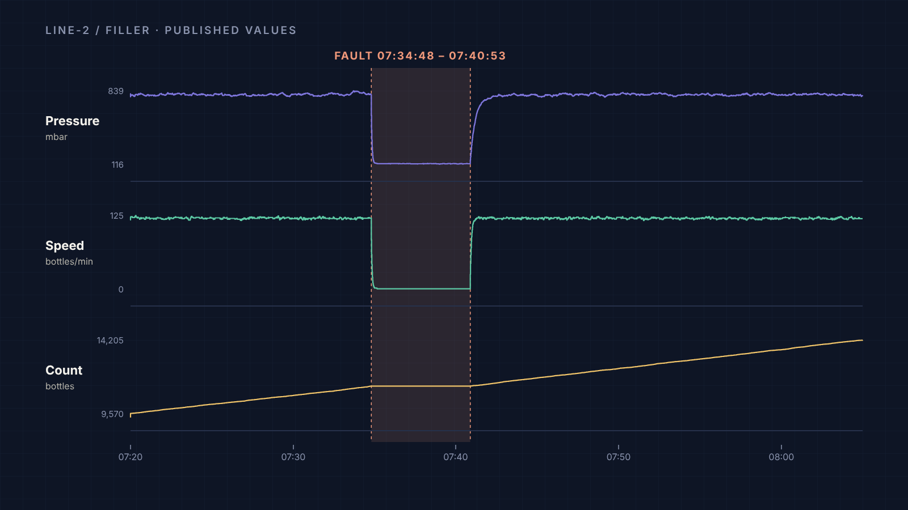
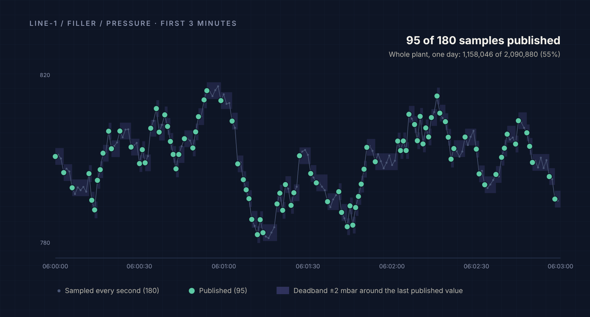
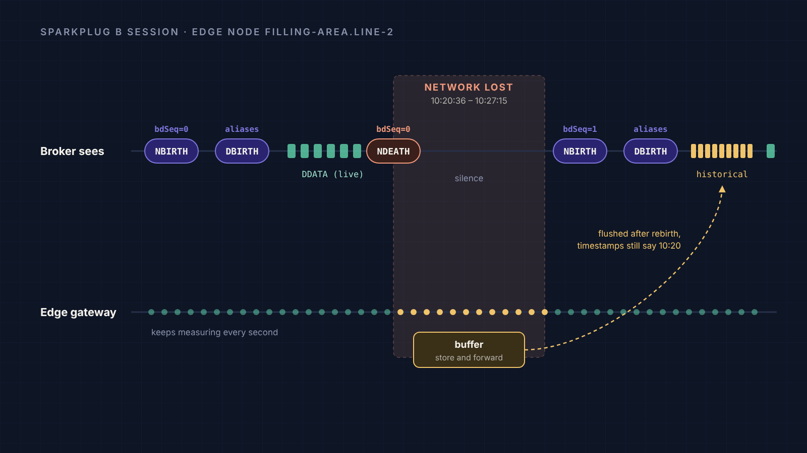

<p align="center">
  
</p>

<p align="center">
  <a href="https://github.com/BuseKaylan/uns-to-lakehouse/actions/workflows/tests.yml"></a>
  
  
  
  <a href="LICENSE"></a>
  <a href="https://medium.com/@busekaylan"></a>
</p>

<h3 align="center">Factories stream millions of sensor readings a day.<br>Almost none of it reaches the people who could learn from it.</h3>

<p align="center">
  A virtual factory, a Sparkplug B toolkit and a series of reproducible experiments<br>
  for bridging the <b>Unified Namespace</b> and the <b>open lakehouse</b>, measured, not guessed.
</p>

---

## Why this exists

A Unified Namespace (UNS) is great at answering *"what is happening right now?"*. Factories also ask questions that need **history next to business data**: why scrap went up last month, what a bearing looked like before it failed, which customer order ran on which line.

That bridge is surprisingly under-documented. *"Just write MQTT to Iceberg"* runs into hierarchy hidden in topic strings, report-by-exception silence, late data after network outages and millions of tiny writes. This project **measures those problems first**, publishes the numbers, and then builds an open-source connector that solves them.

<p align="center"></p>

## Highlights

- 🏭 **A virtual factory that misbehaves on purpose.** 8 machines and 37 signals with report-by-exception, machine faults, stuck sensors, network outages with store-and-forward, and slow wear.
- ⚡ **Sparkplug B, end to end.** Births, deaths, aliases, `bdSeq`, `seq` and historical rebirth flushes, built on a dependency-free payload codec you can read in one sitting.
- 🎯 **Reproducible to the row.** One seed, same data on every machine. Every run also writes a **ground truth** file, so experiments can measure correctness, not just speed.
- 📊 **Experiments with published numbers.** Storage formats, table layouts, partitioning, commit intervals, throughput and correctness, each one a blog post.
- 🧩 **Three ways out.** Parquet files for benchmarks, plain UNS JSON topics, or Sparkplug B over any MQTT broker.

## Quickstart

### 1. One simulated day as Parquet (no broker needed)

```bash
git clone https://github.com/BuseKaylan/uns-to-lakehouse.git
cd uns-to-lakehouse
make install        # creates .venv and installs the project
make dataset        # one simulated day in ~10 seconds
```

```
data/day-1/
├── readings.parquet       1,158,046 published readings
├── ground_truth.parquet   what really happened: 68 faults, 5 frozen sensors, 8 outages
└── run.json               seed, duration, counts
```

### 2. Watch the live factory over MQTT

With Docker:

```bash
SPEED=60 docker compose up -d --build              # Mosquitto + factory publishing Sparkplug B at 60x speed
docker compose --profile debug up listener         # decoded traffic
```

Without Docker, using a local [Mosquitto](https://mosquitto.org/) broker:

```bash
mosquitto -c docker/mosquitto.conf                                     # terminal 1
.venv/bin/unslake simulate --mode sparkplug --duration 1d --speed 60   # terminal 2
make listen                                                            # terminal 3
```

At 60x speed a full factory day, outages included, flows by in 24 minutes.

## A factory that misbehaves on purpose

The plant follows the ISA-95 hierarchy most UNS designs use, **site / area / line / machine / metric**, and lives in a single file: [`config/factory.yaml`](config/factory.yaml). Growing it to 50 machines is a config change, not a code change.

<p align="center"></p>

When a machine faults, its signals react together: speed drops to zero, pressure falls, the counter stops, and everything recovers when the fault clears.

<p align="center"></p>

Like real devices, sensors only publish when a value moves beyond its **deadband**, plus a heartbeat. Almost half of all samples are never sent, which is exactly what makes silence ambiguous downstream.

<p align="center"></p>

| Behaviour | Why it matters for a lakehouse |
|---|---|
| Report-by-exception | A gap in the data doesn't mean the value was missing |
| Machine faults | Signals change together; downtime must be derived from state |
| Frozen sensors | Data keeps arriving, but it's wrong |
| Network outages + store-and-forward | Data arrives minutes late, with old timestamps |
| Slow wear | Long histories are needed for predictive maintenance |

## Sparkplug B, end to end

Each line is an edge node, each machine a device. The simulator follows the full session lifecycle, including what happens when the network drops:

<p align="center"></p>

```
$ make listen
NBIRTH filling-area.line-2              bdSeq=0 seq=0
DBIRTH filling-area.line-2/filler       seq=1 aliases: pressure=1, temperature=2, speed=3, vibration=4, count=5, state=6
DDATA  filling-area.line-2/filler       seq=4   pressure=802.553@06:00:00.000  speed=120.785@06:00:00.000 ...
NDEATH filling-area.line-2              bdSeq=0
NBIRTH filling-area.line-2              bdSeq=1 seq=0
DDATA  filling-area.line-2/filler       seq=6   count=28614@10:20:36.000 (historical)  pressure=804.808@10:20:37.000 (historical) ...
```

| Sparkplug | Maps to | Example |
|---|---|---|
| group_id | site | `acme-plant` |
| edge node | area + line | `filling-area.line-2` |
| device | machine | `filler` |

- `NBIRTH` carries `bdSeq`; the matching `NDEATH` is registered as the MQTT last will.
- `DBIRTH` announces every metric's name, alias and datatype. `DDATA` sends **aliases only**.
- `seq` counts 0 to 255 per edge node.
- After an outage the node is reborn with `bdSeq + 1` and flushes its buffer with `is_historical = true`.

Prefer plain topics? `--mode mqtt` publishes `acme-plant/filling-area/line-2/filler/pressure` with `{"value": 812.4, "unit": "mbar", "timestamp": 1767592800000}`.

## The blog series

| Part | Topic | Status |
|---|---|---|
| 1 | The missing link in factory data | ✅ published |
| 2 | Building a virtual factory | ✅ published |
| 3 | How much space does sensor data really take? | ✅ code and results ready |
| 4–8 | Table layout, partitioning, small files, throughput, correctness | ⏳ planned |
| 9–13 | Building the UNS to Iceberg connector | ⏳ planned |

Follow along on [Medium](https://medium.com/@busekaylan).

## Experiments

Every experiment uses the same config and seed, captures the environment it ran on, and reports the median of several runs. See [`benchmarks/README.md`](benchmarks/README.md).

```bash
make bench-storage     # experiment 01: one day of sensor data as JSON, CSV and Parquet variants
```

## Dataset schema

`readings.parquet`, one row per published reading:

| Column | Type | Description |
|---|---|---|
| event_ts | int64 | Measurement time, ms since epoch (UTC) |
| delivered_ts | int64 | When the reading reached the broker; later than `event_ts` after an outage |
| site, area, line, machine | string | ISA-95 hierarchy |
| metric, unit | string | Signal name and unit |
| value | float64 | Numeric value (null for `state`) |
| value_str | string | State value (null for numeric metrics) |
| historical | bool | True for data delivered late via store-and-forward |

`ground_truth.parquet`: `kind` (`machine_fault`, `frozen_sensor`, `edge_outage`), `path`, `metric`, `start_ts`, `end_ts`.

## CLI

```
unslake info                                   show the plant hierarchy
unslake simulate --mode file|mqtt|sparkplug    run the factory
        --duration 90s|15m|6h|1d               simulated time span
        --speed 1                              live modes: 1 = real time, 60 = 60x, 0 = no pacing
        --out data/run                         file mode output directory
        --seed 42                              override the config seed
        --host / --port                        MQTT broker (default from config)
unslake listen --mode sparkplug|mqtt           print decoded traffic
        --topic, --limit, --seconds
```

All commands accept `--config path/to/factory.yaml` before the subcommand.

## Project structure

```
.
├── config/factory.yaml          plant hierarchy, signals, faults, outages
├── src/unslake/
│   ├── sim.py                   simulation engine: signals, faults, outages, report-by-exception
│   ├── sparkplug.py             dependency-free Sparkplug B payload codec
│   ├── sinks/                   Parquet, UNS JSON and Sparkplug B outputs
│   ├── listen.py                traffic decoder
│   ├── config.py                config loading and validation
│   └── cli.py                   the `unslake` command
├── benchmarks/                  experiments and their results
├── tests/                       unit tests
├── docs/images/                 diagrams used in this README
├── notes/                       study notes template
├── docker-compose.yml
└── Dockerfile
```

## Roadmap

- [x] Virtual factory: hierarchy, signals, faults, frozen sensors, outages
- [x] Outputs: Parquet, UNS JSON, Sparkplug B
- [x] Experiment 01: storage footprint
- [ ] Lakehouse stack in Docker (MinIO + Iceberg REST catalog)
- [ ] Experiments 02–06: table layout, partitioning, commit interval, throughput, correctness
- [ ] UNS to Iceberg connector
- [ ] Rule engine for downtime events, with backtesting on history

## Contributing

Ideas, issues and pull requests are welcome, especially from people who run real plants. If your factory data behaves in a way this simulator doesn't capture yet, please open an issue and describe it.

## License

[Apache License 2.0](LICENSE)
